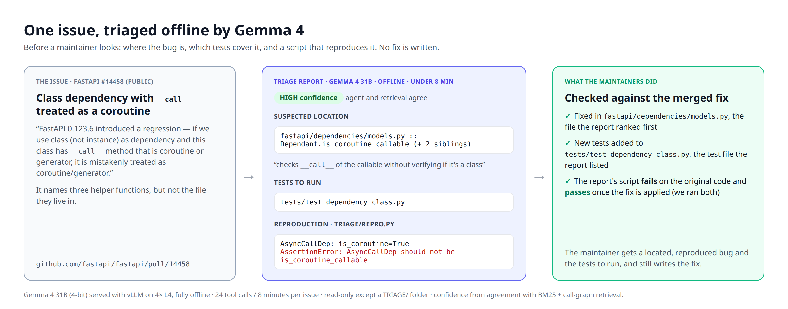
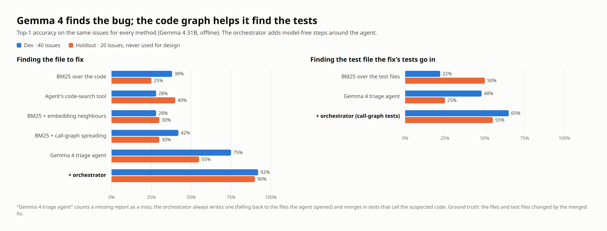

# Gemma 4 Issue Triage

**Locate the bug, find the tests, reproduce it — offline, before a human looks. Never auto-fix.**

> Code for the paper *Triage, Don't Fix* (Gemma 4 Developer Agent Paper Track, Kaggle, 2026).
> See it run: the Kaggle notebook [triage-demo](https://www.kaggle.com/code/rishikeshbharatkoli/triage-demo)
> triages three real issues end to end and prints the reports. Design: [docs/ARCHITECTURE.md](docs/ARCHITECTURE.md).
> Deploying it: [the Triage Playbook](docs/PLAYBOOK.md) ([PDF](docs/playbook.pdf)), eight measured rules for maintainers.
> Companion paper: *Fixing the Context Didn't Fix the Agent*, with its playbook [Before You Trust the Pass Rate](docs/eval_playbook.pdf) (PDF), nine measured rules for building and evaluating a small coding agent.

When a new issue is filed, a maintainer's first hour goes to three questions: *where in the code is
it, which tests cover that code, and can I reproduce it?* This tool answers them with an offline
Gemma 4 agent and the repository's code graph, then hands the report to the maintainer with a
confidence level. It writes no fix: in our measurements, agents that find the right file still get
the fix wrong surprisingly often, and their own tests rarely notice.

## Example

## Results

The figure shows the first run of Gemma 4 31B on 40 dev and 20 holdout issues from the competition's
repositories (regenerate it with `python docs/make_results_chart.py`). The agent's prompt was written
from dev issues only; the orchestrator's rules were chosen after this run. The other-projects column
and the runs listed below used the orchestrator frozen, so they are its clean test.

| Top-1, Gemma 4 31B | Dev (40) | Holdout (20) | Other projects (30) |
|---|---|---|---|
| Right file: retrieval alone (BM25 + call graph) | 42% | 30% | 40% |
| Right file: agent alone | 75% | 55% | 43% |
| Right file: **agent + orchestrator** | **92%** | **90%** | **83%** |
| Right test file: agent + orchestrator | 65% | 55% | 63% |

- **Other projects:** 30 SWE-bench Verified issues from Django, SymPy, Sphinx, xarray, pytest and
  pylint, with code graphs from `triage/build_graph.py`. Agent and orchestrator unchanged.
- **Second run** on the same 60 issues: right file 88% / 95%, right test file 55% / 55%.
- **Confidence:** reports labelled HIGH or MEDIUM were right 73 of 74 times across the three single-agent 31B runs.
- **Reproduction:** judging by the script's exit code instead of the agent's claim raises the share of
  "reproduced" that hold up against the real fix from 44% to 61%.
- **Gemma 4 E4B** on one L4: the orchestrator lifts it from 28% / 35% to 62% / 60% right file, but E4B
  edited source code in 18 of 60 runs (31B: once in 150 single-agent runs). Mount the source read-only.

## Reproduce the paper

Competition data may not be redistributed, so this repository ships the scripts that rebuild every
number, not their outputs. You need a Kaggle account that has joined the competition.

| Step | Runs on | Time | Paper |
|---|---|---|---|
| Data, split, labels, retrieval baselines (`eval/make_split.py`, `triage_labels.py`, `triage_localize.py`) | laptop, CPU | a few minutes | Table 1 retrieval rows, Table 2 |
| Agent runs (`notebooks/make_demo_notebook.py --subset dev`, or `holdout`; two agents, E4B and outside issues by flag) | Kaggle, 4×L4 | about 1 h per 40 issues | every agent row, §4.6–4.9 |
| Reproduction check (`eval/make_repro_check_notebook.py`) | Kaggle, CPU | about 5 minutes | §4.4 |
| Outside issues: snapshots and graphs (`eval/make_ext_tasks_notebook.py`) | Kaggle, CPU | about 20 minutes | §4.7 |
| Scoring (`triage_reports.py`, `triage_pipeline.py`, `paper_stats.py`) | laptop, CPU | under 20 seconds | Tables 1–2, §4.1–4.9, McNemar tests, 73 of 74 |

Every command, and the script behind each number: [eval/README.md](eval/README.md). Agent sampling is
not seeded, so new runs give numbers like ours rather than identical ones; every step after the agent
run is deterministic.

## What you get per issue

- **Suspected location**: ranked files and functions, with evidence
- **Tests to run**: existing tests that exercise that code
- **Reproduction**: a small script that fails while the bug is present
- **Confidence**: HIGH / MEDIUM / LOW, so maintainers know which reports to trust
- **Open questions**: what the agent could not determine

## Layout

| Path | What |
|---|---|
| `agent/` | The triage agent: config, prompt, sampling, per-issue budget (24 tool calls, 8 minutes) |
| `agent_multi/` | The two-agent variant from the paper (localizer → reproducer, same budget); it did worse |
| `triage/` | Deterministic steps around the agents: retrieval (BM25 + call-graph spreading), agreement-based confidence, call-graph test finder, a reproduction check that re-runs the script, the report writer (`python -m triage.orchestrate`), and a code-graph builder for any Python repository (`python -m triage.build_graph`) |
| `tests/` | Self-contained tests (`python -m pytest tests`) |
| `notebooks/` | `make_demo_notebook.py` builds the [triage-demo](https://www.kaggle.com/code/rishikeshbharatkoli/triage-demo) Kaggle notebook: real issues triaged end to end with Gemma 4, printing the maintainer's reports |
| `eval/` | Rebuild the labels, baselines and every number in the paper from the competition data ([eval/README.md](eval/README.md)) |
| `docs/` | Architecture, the maintainers' playbook ([PLAYBOOK.md](docs/PLAYBOOK.md), [PDF](docs/playbook.pdf)), Paper 1's evaluation playbook ([PDF](docs/eval_playbook.pdf)), figures, example reports |

No competition data, labels or traces are included; the evaluation scripts rebuild them for anyone
with access to the competition data.

## License

Apache 2.0.
