# Architecture

Offline issue triage with Gemma 4: when a new issue arrives, answer the maintainer's first three
questions (where is it, which tests cover it, can it be reproduced) before a human looks, on one
machine, without writing a fix.

The figure plays the story of one issue once, stage by stage, then keeps particles flowing along every
connection. Each check feeds one field of the report. For places that don't play SVG animation (slides,
the Kaggle writeup): [architecture.gif](architecture.gif), and a static [architecture.png](architecture.png).
All three come from [make_architecture.py](make_architecture.py) (`--gif` for the GIF). Blue marks
Gemma 4, orange marks deterministic code, and the gradient marks where the two meet.

## Components

| Step | Kind | What it does | Measured (dev · holdout, 40 · 20 issues) |
|---|---|---|---|
| Triage agent | Gemma 4 31B, 4-bit; 24 tool calls, 8 min | Searches, reads and runs code; writes only `TRIAGE/report.md`, `TRIAGE/repro.py` | Right file first 75% · 55%; when it wrote a report, 41 of 43 |
| 1 Fallback chain | Python | Agent's report, else the files it opened (from its trace), else retrieval | A report for 60 of 60 issues; the opened-files fallback was right 14 of 17 times |
| 2 Retrieval | BM25 + call-graph spreading | A model-free second opinion on the location | 42% · 30% alone; 0.1 s per issue |
| 3 Confidence | Agreement of 1 and 2 | HIGH: same top file; MEDIUM: in retrieval's top 3; LOW otherwise | HIGH and MEDIUM were right 29 of 29 times; LOW 26 of 31 |
| 4 Call-graph tests | Code graph | Test files whose functions call the suspected module, merged with the agent's | Right test file first: 48% · 25% → 65% · 55% |
| 5 Reproduction check | Runs `TRIAGE/repro.py` | Non-zero exit on the current code means REPRODUCED, whatever the agent claimed | "Reproduced" right 61% of the time vs 44% for the agent's own claim |
| Report | Template | Location, confidence and why, tests, reproduction output, open questions | Nothing in it is generated freely |
| Maintainer | Human | HIGH: approve; LOW: check first; disagree: add a hint to the issue and re-run | The tool never edits code (0 of 60 runs touched source files) |

## What we tried and dropped

**Two agents, localizer → reproducer**, each with its own prompt and a fresh context for the second,
within the same 24-call, 8-minute budget. It did worse: right file 88% vs 92%, right test file 50% vs
62%, and 6 of 60 runs wrote outside `TRIAGE/` (one edited source files). The localizer ignored its
10-call share (median 15–17 calls), leaving the reproducer too little budget; prompts cannot enforce a
split, and one agent spends the budget where the issue needs it.

## Where it runs

- **Evaluated:** Gemma 4 31B (4-bit) on 4×L4 (Kaggle), served with vLLM, fully offline.
- **Next:** Gemma 4 E4B on a single L4 (`notebooks/make_demo_notebook.py --model gemma-4-e4b-it-qat-w4a16-ct --gpus 1`), not yet measured.

## Post-training (planned)

A LoRA adapter for the triage agent, trained only on Gemma's own verified triage outputs for tasks
never used for evaluation (no data from other models), aiming to do the same work in fewer tool calls.
