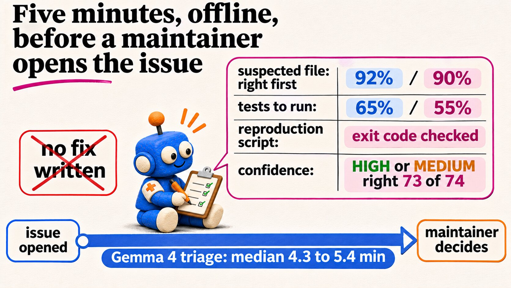
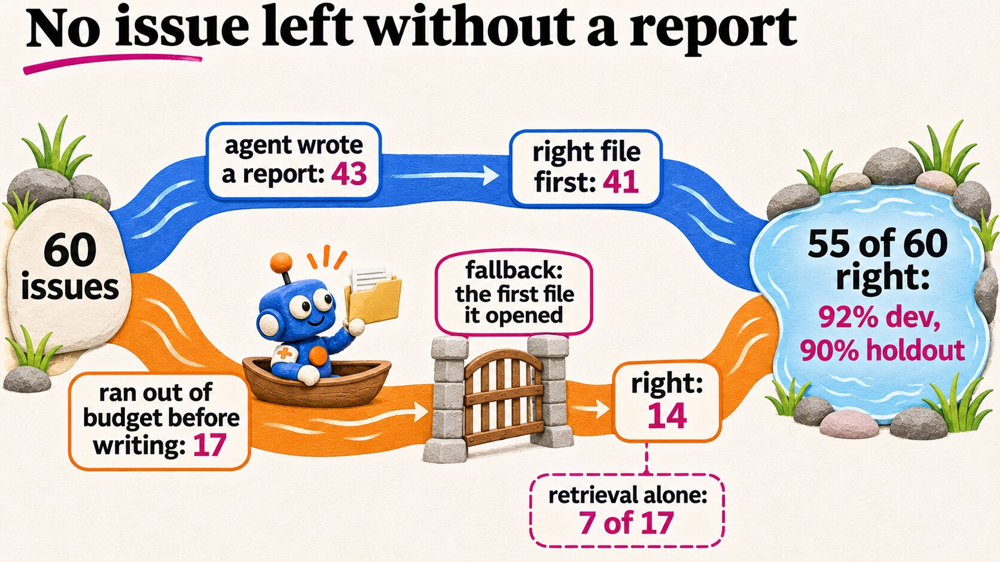
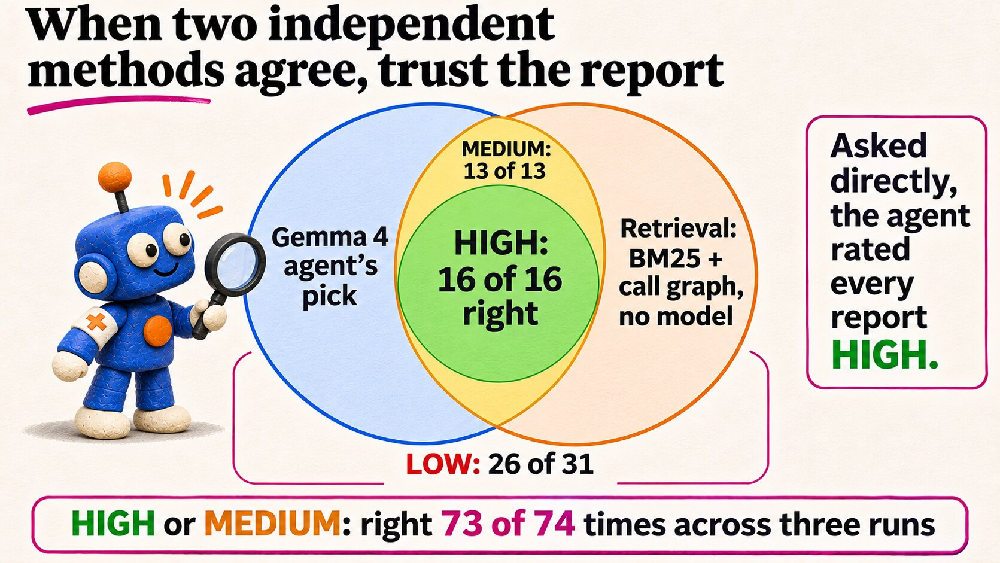
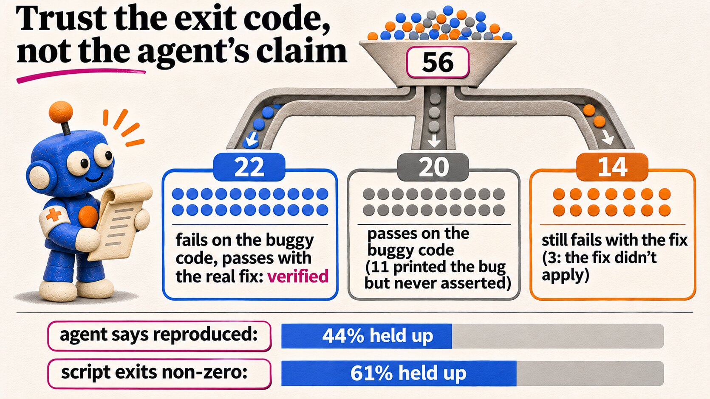
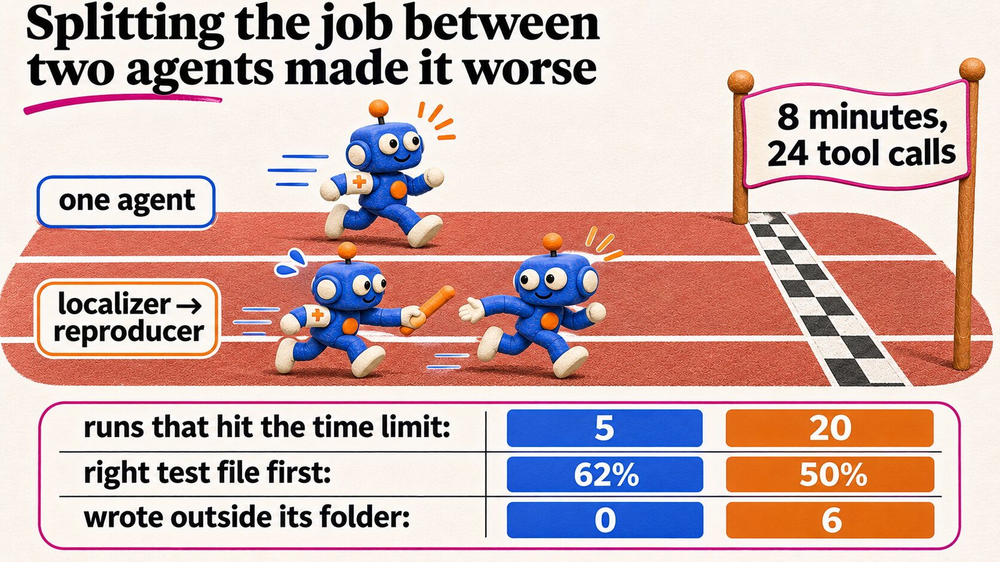
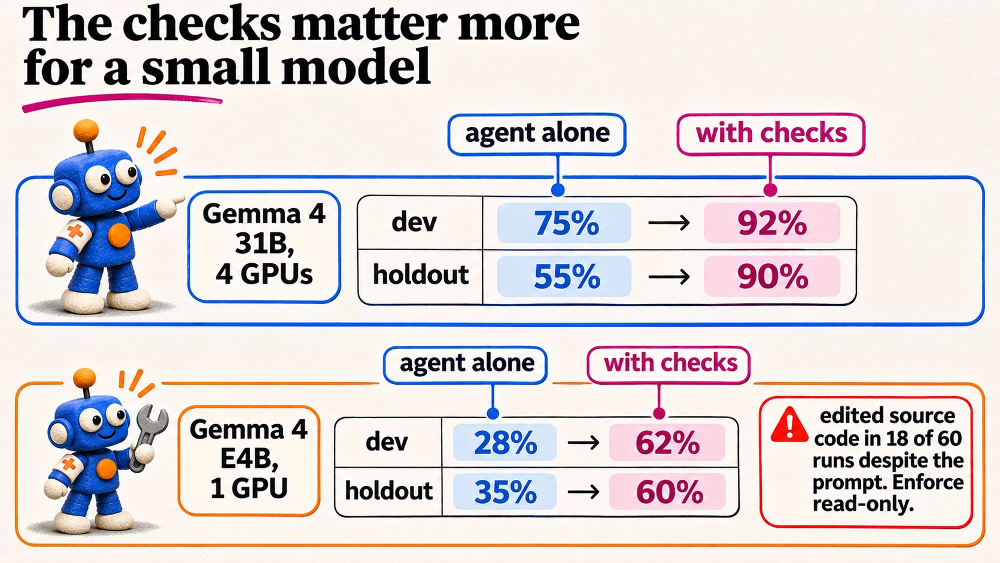
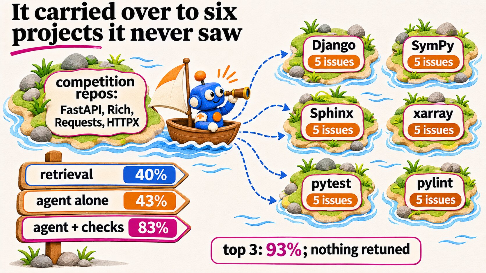
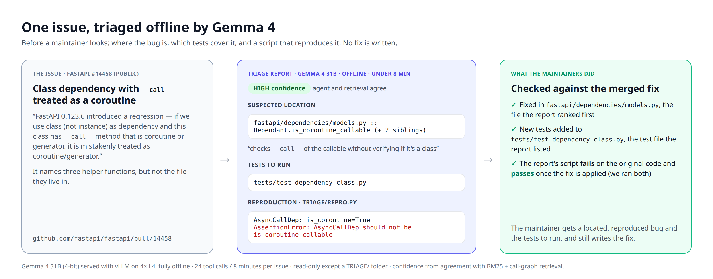

# The Triage Playbook

**Put an offline Gemma 4 agent in front of your issue tracker.** For every new issue it says where the
bug is, which tests cover that code and whether it reproduces. It leaves the fix to you.

<p align="center"></p>

Illustrated version: [playbook.pdf](playbook.pdf) (11 pages). Every number comes from the paper
*Triage, Don't Fix* (Koli, 2026); section numbers point to it.

| | |
|---|---|
| Right file to fix ranked first | **92% / 90%** on 40 dev / 20 holdout issues (FastAPI, Rich, Requests, HTTPX) |
| On six other projects, unchanged | **83%** on 30 SWE-bench Verified issues (retrieval alone: 40%) |
| Reports labelled HIGH or MEDIUM | right **73 of 74** times, across three runs |

## Eight plays

1. **Ask three questions. Never ask for a fix.** Where is it, which tests cover it, does it reproduce.
   As a fixing agent, Gemma 4 31B touched the right file in 91% of its patches, yet its own final check
   passed 31 of 32 wrong fixes (§1).
2. **Give it a budget, and make it write early.** 24 tool calls and 8 minutes; the report must exist by
   call 14. Its main failure was running out before writing, and even then the first file it had opened
   was right 14 of 17 times (§4.4).
3. **Wrap the agent in code that does not trust it.** A fallback chain, model-free retrieval, agreement
   confidence, call-graph tests and a re-run reproduction, with no model calls. Right file first: 75% →
   92% on dev, 55% → 90% on holdout, and every issue gets a report (§4.1, §4.4).
4. **Score confidence by agreement, not by asking.** HIGH when the agent and BM25 + call-graph retrieval
   pick the same file, MEDIUM when the agent's pick is in retrieval's top 3. The agent called every
   report HIGH; agreement HIGH or MEDIUM was right 73 of 74 times (§4.5, §4.7, §4.9).
5. **Trust the exit code, not the claim.** Run `TRIAGE/repro.py` yourself: non-zero on the current code
   means reproduced. "Reproduced" held up against the real fix 61% of the time instead of 44% (§4.4).
6. **Find tests through call edges.** Rank test modules by the calls that go from them into the suspected
   module, and merge them with the agent's list. Right test file first: 48% → 65% on dev; pooled, 13
   wins and 0 losses. Embeddings did no better than BM25 (§4.2, §4.3).
7. **Enforce read-only in the sandbox, not in the prompt.** The prompt forbids edits; Gemma 4 E4B still
   edited source in 18 of 60 runs, and 31B twice in 210 (§4.8, §6).
8. **Use one agent, not two.** A localizer handing off to a reproducer, with the same budget: right test
   file 62% → 50%, and runs that hit the time limit went from 5 to 20. A prompt cannot make the first
   agent stop on time (§4.6).

> **The rule behind all eight:** let the model look, let code decide what the maintainer sees, and let
> the maintainer fix.

## The plays in pictures

<p align="center"></p>

**Play 1.** Three answers and a confidence level in about five minutes, offline. No fix. Percentages are dev / holdout (§1, §4.1, §4.3).

<p align="center"></p>

**Plays 2 and 3.** When the agent runs out of budget, the first file it opened becomes the report. That fallback is where the orchestrator's location gain comes from (§4.4).

<p align="center"></p>

**Play 4.** Confidence comes from agreement with model-free retrieval. Asked directly, the agent rated every report HIGH (§4.5, §4.7, §4.9).

<p align="center"></p>

**Play 5.** The orchestrator re-runs the agent's script and reports REPRODUCED only from its exit code (§4.4).

<p align="center"></p>

**Play 8.** Same budget, two agents: the first one rarely stopped in time to hand over (§4.6).

<p align="center"></p>

**Play 7.** The small model gains most from the checks, and ignores the prompt's ban on edits. Enforce read-only in the sandbox (§4.8).

<p align="center"></p>

**Other projects.** 30 SWE-bench Verified issues, with the agent, prompt and orchestrator frozen: its clean test (§4.7).

## How it works

<p align="center"></p>

Details and measured effect of each step: [ARCHITECTURE.md](ARCHITECTURE.md).

## What each part adds

Neither half works alone. Top-1, Gemma 4 31B; retrieval is BM25 with call-graph spreading for files
and BM25 over test files for tests (§4.1, §4.3, §4.7).

| | Dev (40) | Holdout (20) | Six other projects (30) |
|---|---|---|---|
| Right file: retrieval alone | 42% | 30% | 40% |
| Right file: agent alone | 75% | 55% | 43% |
| Right file: **agent + orchestrator** | **92%** | **90%** | **83%** |
| Right test file: retrieval alone | 22% | 50% | 33% |
| Right test file: agent alone | 48% | 25% | 37% |
| Right test file: **agent + orchestrator** | **65%** | **55%** | **63%** |

On other projects the agent alone barely beat retrieval (43% against 40%) because it wrote a report on
only 13 of 30 issues. On 16 others, the files it had opened were right 12 times: the fallback chain
turned what it had seen into 83%. The orchestrator's rules were chosen after seeing dev and holdout, so
the six other projects (SWE-bench Verified, run with everything frozen) are its clean test.

**Choosing a model.** The checks matter more for a small one (right file first, dev / holdout, §4.8):

| | Agent alone | + orchestrator | Runs that edited source |
|---|---|---|---|
| Gemma 4 31B, 4-bit, 4×L4 | 75% / 55% | 92% / 90% | 0 of 60 |
| Gemma 4 E4B, 4-bit, one L4 | 28% / 35% | 62% / 60% | 18 of 60 |

E4B alone does worse than retrieval; the orchestrator doubles it, and its HIGH reports were right 11 of
12 times. It also ignored the prompt's ban on edits, so mount the source read-only.

**Cost per issue.** The agent: a median 4.3 to 5.4 minutes (31B on 4×L4). Retrieval: 0.1 s on a CPU,
and with no GPU at all you still get a LOW-confidence first look. The code graph: seconds, once per
repository.

## Run it on your repository

The orchestrator and the graph builder are plain Python (standard library only). The agent needs a GPU
and, today, the competition's harness.

**1. Laptop, seconds: build the code graph and get a retrieval-only report.** Without the agent you
still get ranked suspects and call-graph tests, at LOW confidence.

```bash
git clone https://github.com/Rishikoli/gemma4-issue-triage && cd gemma4-issue-triage
python -m triage.build_graph /path/to/your/repo --out graph.json
# per issue: put its title and text in issue.md
python -m triage.orchestrate --workspace /path/to/your/repo --issue issue.md \
    --graph graph.json --no-repro      # writes TRIAGE/final_report.md and prints it
```

**2. GPU, about 5 minutes per issue: run the triage agent.** The agent is declarative:
[agent/agent.yaml](../agent/agent.yaml) (Google ADK), the prompt
[agent/prompts/triage.md](../agent/prompts/triage.md) and the budget in
[agent/eval_config.yaml](../agent/eval_config.yaml). We ran it only inside the Gemma 4 Developer Agent
harness on Kaggle (Gemma 4 31B 4-bit on vLLM, 4×L4; median 4.3 to 5.4 minutes per issue), which needs
the competition's data. `notebooks/make_demo_notebook.py` builds that notebook (the public
[triage-demo](https://www.kaggle.com/code/rishikeshbharatkoli/triage-demo)); issues from another project
can be packaged as tasks the way the paper did for Django and SymPy (`eval/make_ext_tasks_notebook.py`).

**3. CPU, seconds: turn the agent's notes into the report.**

```bash
python -m triage.orchestrate --workspace /path/to/your/repo --issue issue.md \
    --graph graph.json --trace trace.json   # the trace gives the opened-files fallback
```

Without `--no-repro` the orchestrator **executes the script the agent wrote**. Run this step in the same
sandbox as the agent: no network, source read-only.

## Reading a report

<p align="center"></p>

| The report says | How often it was right | What to do |
|---|---|---|
| **HIGH** | 16 of 16 on our issues; 11 of 11 on six other projects | Start at suspect 1. Run the listed tests before and after your fix. |
| **MEDIUM** | 13 of 13; 5 of 5 on other projects | Start at suspect 1, and keep retrieval's top pick (shown in the report) in view. |
| **LOW** | 26 of 31 (84%); 9 of 14 on other projects | Check first: all five wrong reports were LOW. Compare the suspects with retrieval's top 3. |
| Source: files the agent opened | 14 of 17 on our issues; 12 of 16 elsewhere | The agent ran out of budget before writing. Its first file is still a good bet; treat it as LOW. |
| REPRODUCED | 61% held up against the real fix | Run `TRIAGE/repro.py`: it should fail now and pass after your fix. If it still fails after a correct fix, its expectation was wrong (14 of 36). |
| NOT_REPRODUCED | in 11 of 20, the script printed the bug but forgot to `assert` | Read its output. The location and tests are still useful. |

HIGH, MEDIUM and LOW counts are from the first run on 60 issues (§4.5) and the 30 outside issues (§4.7).
In a second run on the same 60 issues, HIGH or MEDIUM was wrong once in 29 (§4.9).

## Putting it to work

A design sketch: we evaluated the parts, not this deployment.

**Issue opened** → **sandbox + agent** (source read-only, `TRIAGE/` writable, no network, 24 calls / 8
min) → **orchestrator** → **comment and label** (`triage: HIGH` / `MEDIUM` / `LOW`; never a pull
request) → **maintainer** decides, fixes, closes.

**Before you switch it on, calibrate.** Our numbers come from 90 issues in 10 projects. Measure on your
own history first: take 20 to 40 closed issues with a merged fix, label each the way the paper did (the
location is the non-test files the fix changed; the tests are the test files its new tests went into),
triage them at the fix's parent commit, and count how often HIGH and MEDIUM were right.

**Known limits.** Small samples (60 issues run twice, 30 run once); Python only; labels come from one
merged fix, so another valid location counts as wrong.

### Deployment checklist

Sandbox
- [ ] Source mounted read-only; only `TRIAGE/` is writable (play 7).
- [ ] No network; `repro.py` runs only inside the sandbox.
- [ ] 24 tool calls and 8 minutes; the report is written by call 14 (play 2).

Report
- [ ] Confidence comes from agreement with retrieval, never from the model (play 4).
- [ ] REPRODUCED comes only from the script's exit code (play 5).
- [ ] Each report shows its source and retrieval's top 3.

Process
- [ ] Calibrated on 20 to 40 of your closed issues.
- [ ] The bot comments and labels. It never opens a pull request or closes an issue.
- [ ] Re-calibrate after changing the model, the prompt or the budget.

---

Rebuild the PDF from [playbook.html](playbook.html):
`google-chrome --headless=new --no-pdf-header-footer --virtual-time-budget=15000 --print-to-pdf=docs/playbook.pdf docs/playbook.html`.
